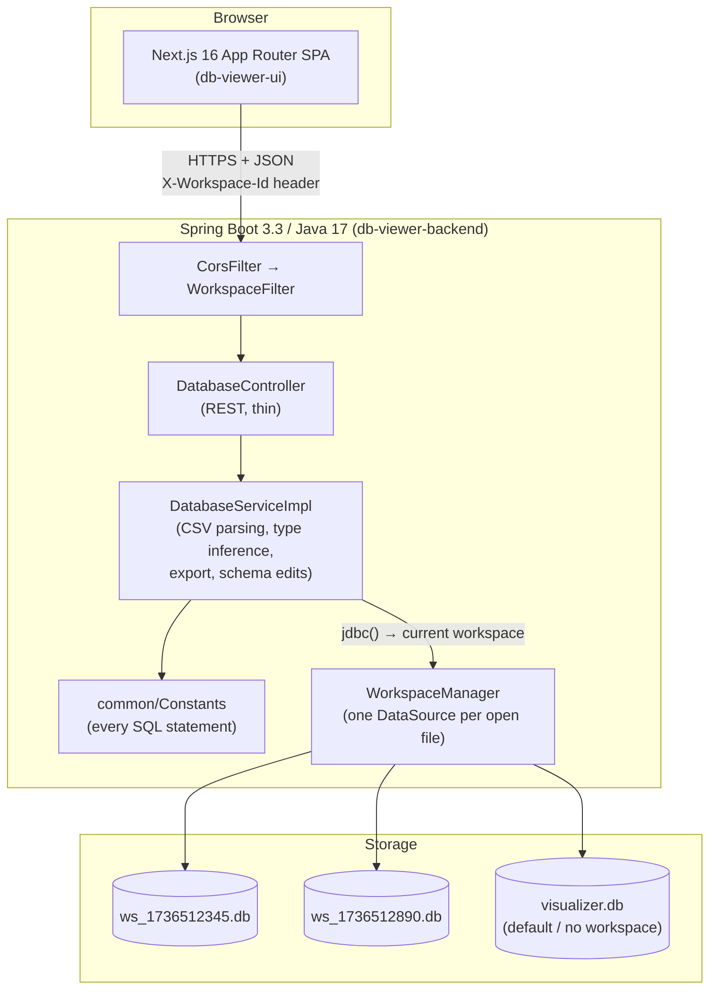
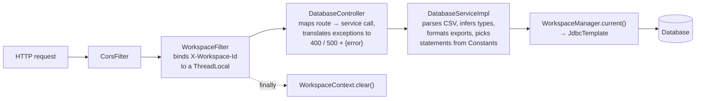
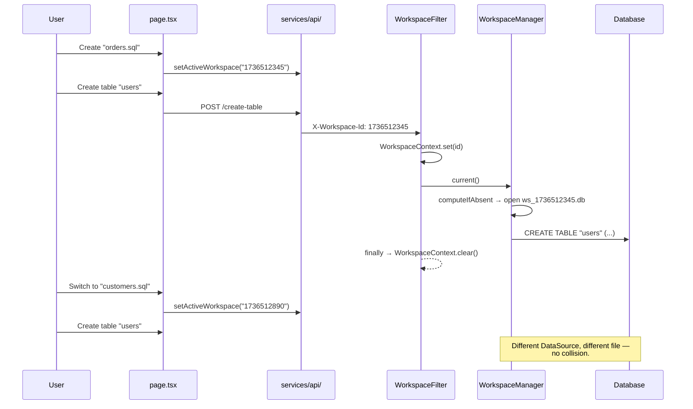
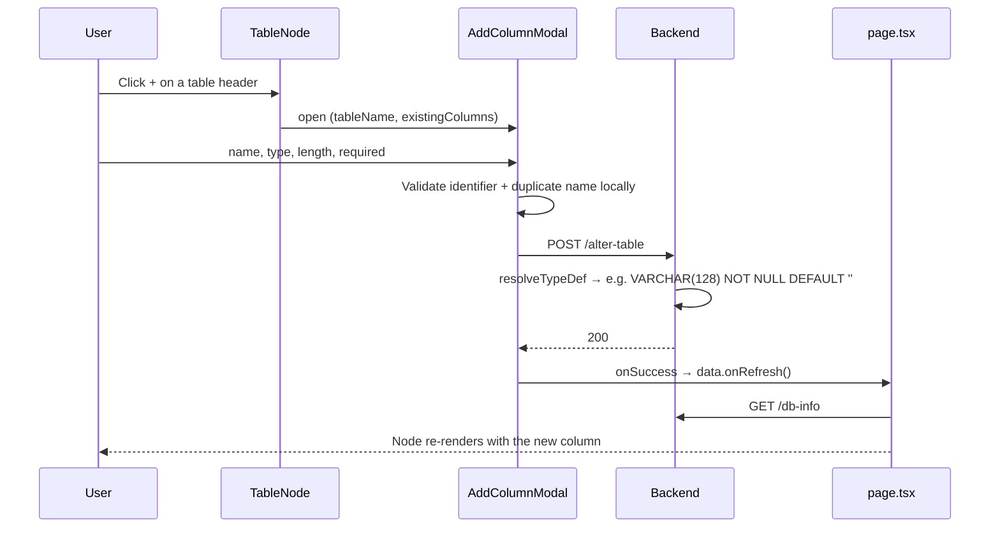
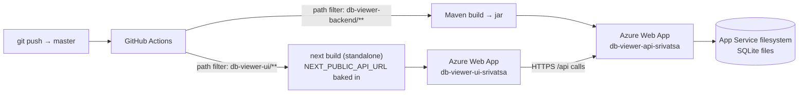
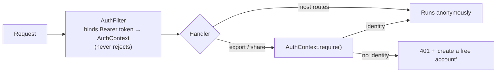

# System Design — SQL Visualizer

> Companion document: [DATABASE-DESIGN.md](./DATABASE-DESIGN.md) covers the storage layer,
> schema rules, and type mapping. This document covers everything above it — the runtime
> architecture, request flows, and deployment topology.

---

## 1. What the system does

SQL Visualizer is a two-tier web application for **exploring and editing relational data without
installing a database client**. A user drops in a `.csv` or `.sql` file (or starts from an empty
file), and the system:

1. Materialises the file's contents into a **real, queryable database**.
2. Reflects that database's schema back to the browser as an **interactive entity-relationship
   diagram**.
3. Lets the user mutate the live schema and data — create tables, add columns, insert/update/delete
   rows — with every change executed as actual SQL.
4. Exports the result back out as a CSV file (single table) or a SQL dump (whole workspace).

The important consequence of design decision (1) is that this is **not a diagram editor**. There is
no in-memory model of "a schema" that gets serialised on save. The database *is* the model; the
canvas is a projection of `PRAGMA table_info` / `INFORMATION_SCHEMA`. Every UI action is a DDL or
DML statement, and the diagram is redrawn from a fresh `GET /db-info` afterwards.

---

## 2. High-level architecture



**Tiers**

| Tier | Technology | Responsibility |
|---|---|---|
| Presentation | Next.js 16 (App Router), React 19, TypeScript strict, Tailwind v4, React Flow | Canvas rendering, file explorer, modals, optimistic UI, per-file workspace state |
| Application | Spring Boot 3.3, Spring Web MVC, Spring JDBC | REST surface, request→workspace binding, SQL generation, CSV/SQL parsing, export formatting |
| Data | SQLite (default) or MySQL 8 | Actual table storage and metadata; the single source of truth for the schema |

There is no ORM, no persistence entity layer, and no migration tooling — deliberately. The
application's whole job is to operate on schemas it does not know ahead of time, so everything goes
through `JdbcTemplate` with reflection-style metadata queries.

---

## 3. Frontend design

### 3.1 Module layout

```
db-viewer-ui/
├── app/
│   ├── layout.tsx          Root layout, JetBrains Mono via next/font
│   ├── page.tsx            Landing page (/): hero, features, templates
│   ├── app/page.tsx        ★ The editor (/app); owns all workspace state
│   ├── share/[token]/      Read-only view of a shared file
│   └── globals.css         Tailwind v4 entry + design tokens
├── components/
│   ├── landing/                    Nav pill, features grid, template catalogue
│   ├── header/Header.tsx           Import / refresh / export / clear / help
│   ├── editor/FileExplorer.tsx     Left tree: files → tables → columns
│   ├── editor/DataEditor.tsx       Row-level view / edit / insert / delete modal
│   ├── canvas/Visualizer.tsx       React Flow canvas + toolbar
│   ├── tables/TableNode.tsx        A single table as a graph node
│   ├── chat/ChatLauncher.tsx       The round button in the canvas's top-right corner
│   ├── chat/SchemaChat.tsx         The panel: a shell column, mirroring FileExplorer
│   ├── chat/ChatConversation.tsx   Messages, examples, composer; keyed per workspace
│   ├── chat/ChatAnswer.tsx         Prose + the fenced SQL block, no markdown dep
│   └── modal/
│       ├── NewFileModal.tsx        Name a new (empty) SQL file
│       ├── CreateTableModal.tsx    Full table definition incl. FKs
│       ├── AddColumnModal.tsx      Single-column ALTER TABLE
│       ├── EditColumnModal.tsx     Rename / retype an existing column
│       ├── NoticeModal.tsx         Import reports: errors and warnings with details
│       ├── NewTableHelpModal.tsx   Canvas toolbar: what the New Table button does
│       └── InfoModal.tsx           "What is this" blurb + version + credits
├── services/
│   ├── api.ts              ★ The only place that talks to the backend
│   ├── chatStore.ts        One assistant conversation per open file, for the tab's lifetime
│   ├── sessionStorage.ts   Open files + layout, persisted across a refresh
│   └── exportImage.ts      Canvas → PNG
├── types/index.ts          Shared response/DTO types
└── hooks/useSchema.ts      Legacy hook, not on the active code path
```

### 3.2 State ownership

`app/page.tsx` is intentionally the single owner of application state. It holds:

```ts
interface Workspace {
    id: string;            // also the backend workspace id
    name: string;          // filename shown in the explorer / used for export
    nodes: Node[];         // React Flow nodes (positions survive refreshes)
    edges: Edge[];         // derived from backend relationships
    fileData: ExplorerFile;// tree projection for the explorer
    isImported: boolean;   // came from an upload vs. created empty
}
```

Child components are presentational and receive callbacks. The two exceptions — `TableNode` and
`DataEditor` — call `dbService` directly for their own mutations and then invoke an `onRefresh`
callback so `page.tsx` re-derives everything from the server. This keeps "who owns the truth"
unambiguous: **the server does**, and local state is a cache that is always thrown away and rebuilt
after a mutation.

Node **positions** are the one piece of genuinely client-side state. `refreshActiveSchema()`
deliberately preserves the existing position of any node whose table still exists, so a refresh does
not scatter a layout the user has arranged.

They are also the only thing worth persisting. `services/sessionStorage.ts` writes
`{id, name, isImported, positions}` per open file to `localStorage`; on mount the page reconciles
that list against `GET /workspaces` and re-reads each schema from `GET /db-info`. **`GET /workspaces` is
the authority on which files exist** — it is scoped to the caller and closing a file deletes its
workspace, so what it returns is exactly the set that should be open; `localStorage` contributes
layout and nothing else. It used to be the other way round, and because signing out clears
`localStorage`, that destroyed the only record of a signed-in user's files. Storing ids and
layout but never the schema keeps the databases as the single source of truth — a cached schema
would be stale the moment any other call changed it.

### 3.3 The API boundary

`services/api/` is the single choke point for backend access. It owns:

- The Axios instance and base URL (`NEXT_PUBLIC_API_URL`, default `http://localhost:8080`).
- The **active workspace id**, applied to every request through an interceptor.
- Cache-busting `_t`/`t` query parameters on schema and table reads.
- URL builders for the two browser-initiated downloads.

```ts
let activeWorkspaceId: string | null = null;

api.interceptors.request.use((config) => {
    if (activeWorkspaceId) config.headers.set('X-Workspace-Id', activeWorkspaceId);
    return config;
});
```

Downloads are the exception that shapes the backend contract: `window.open(...)` and
`<a download>` cannot attach custom headers, so `/export/{table}` and `/export-sql` must also accept
the workspace as a `workspaceId` query parameter.

### 3.4 Rendering constraint worth knowing

React Flow applies a CSS `transform` to its viewport, and the canvas wrapper carries an
`animate-fade-up` class that also sets a transform. A transformed ancestor becomes the containing
block for `position: fixed` descendants, so **a fixed modal nested inside the canvas silently
positions itself against the canvas pane instead of the viewport.** Two mitigations are in use:

- `CreateTableModal` and `NewTableHelpModal` are rendered as *siblings* of the canvas wrapper.
  (`InfoModal` and `NoticeModal` are owned by `page.tsx`, outside the canvas entirely.)
- `AddColumnModal` and `EditColumnModal` are opened from inside a `TableNode` — unavoidably deep
  inside the transformed viewport — so they render through `createPortal(..., document.body)`,
  guarded by a `mounted` flag because `document` does not exist during SSR.

---

## 4. Backend design

### 4.1 Layering



Controllers stay thin — route, delegate, wrap the result or the error. Parsing, type inference
and formatting live in `DatabaseServiceImpl`.

Every service is an interface in `service/` with its implementation in `service/impl/`:
`DatabaseService`, `AuthService`, `JwtService`, `ShareService`, `TemplateService`,
`ChatService`, `ApiKeyService`. Nothing is
typed against a `*Impl` — controllers and services depend on the contract, so Spring injects the
implementation and a collaborator can be substituted without touching the caller. Shapes that are
part of a contract live on the interface too: `TemplateService.Template` and its nested records are
declared there, not on the implementation, because the controller, the schema parser and the tests
all speak in terms of them.

Every SQL statement the application issues lives in `common/Constants.java`, not in the class that
runs it. A service decides *what* to do and supplies the identifiers; the statement itself is read
from a named constant. That keeps the whole SQL surface reviewable in one file, and means a
statement can be corrected without reading the control flow wrapped around it. Two conventions
hold throughout: `?` is a real JDBC bind parameter, and `%s` is a format slot for an identifier
that the caller has already validated — identifiers cannot be bound, so `safeIdentifier` does that
job before the name reaches a statement.

Two classes sit outside that pattern, deliberately. `llm/LlmClient` is a `@Component` with no
interface: there is one implementation, it wraps an HTTP call rather than a decision, and the
thing a test wants to substitute is the *provider*, which a base-URL property already does.
`auth/SecretCipher` is the same — an algorithm, not a policy.

`GlobalExceptionHandler` covers anything that escapes a controller's own try/catch.

### 4.2 Workspace isolation — the central design decision

**Problem.** The UI has always presented multiple open SQL files, but the backend had exactly one
datasource. Every file therefore shared one database: a `users` table created while working in
`orders.sql` appeared in `customers.sql`, and importing two files that both define `users` caused
the second import's `CREATE TABLE` to be silently skipped.

**Solution.** A workspace is a first-class backend concept, and *the file id is the workspace id*.



Key properties:

| Property | Implementation |
|---|---|
| Binding | `WorkspaceFilter` (a `OncePerRequestFilter`) reads `X-Workspace-Id`, falling back to the `workspaceId` query parameter, and binds it to a `ThreadLocal` in `WorkspaceContext` — cleared in a `finally` so pooled request threads never leak a workspace |
| Resolution | `DatabaseServiceImpl.jdbc()` calls `WorkspaceManager.current()` on every statement, so no service method needs to know workspaces exist |
| Materialisation | Lazy. `ConcurrentHashMap.computeIfAbsent` creates the DataSource on a workspace's first request; no "create workspace" call is needed |
| Isolation unit | SQLite: one `.db` file per workspace under `app.workspace.dir`. MySQL: one schema per workspace (`ws_<id>`) |
| Safety | Ids are whitelisted to `[A-Za-z0-9_-]{1,64}` before ever touching a filesystem path or a SQL identifier — path traversal and identifier injection are rejected, not escaped |
| Backward compatibility | A request with **no** workspace id uses the original default datasource, so Swagger, `curl`, health checks, and the existing test suite behave exactly as before |
| Teardown | `DELETE /workspace` closes the DataSource and deletes the file (or drops the schema); `@PreDestroy` closes everything on shutdown |

**Trade-off accepted.** Workspaces are keyed by a browser-generated id with no authentication, so any
client that knows an id can reach that workspace. This matches the app's current threat model
(a single-user developer tool). Section 8 lists what would have to change for multi-tenant use.

### 4.3 API surface

| Method | Path | Purpose | Workspace-scoped |
|---|---|---|---|
| `GET` | `/` | Health check, plus the app version | — |
| `GET` | `/version` | Version declared in `pom.xml`; shown in the UI's info modal | — |
| `POST` | `/import/analyze` | Dry run: the tables, columns and inferred types an import would produce, plus the dialect detected and everything that would be skipped. Writes nothing | ✅ header |
| `POST` | `/upload` | Import `.csv` or `.sql`, applying any `columnTypes` corrections; returns a report of what ran and what was skipped | ✅ header |
| `POST` | `/query` | Execute one raw SQL statement (account required) | ✅ header |
| `GET` | `/db-info` | All tables, columns, row previews, relationships. Columns carry `unique` / `defaultValue` / `autoIncrement`, relationships carry `constraintId` / `onDelete` — the canvas needs all five to draw cardinality and column definitions | ✅ header |
| `GET` | `/table-data/{table}` | Columns + up to 100 rows | ✅ header |
| `POST` | `/create-table` | `CREATE TABLE` with PK/NOT NULL/FK | ✅ header |
| `POST` | `/alter-table` | `ALTER TABLE ... ADD COLUMN` | ✅ header |
| `POST` | `/update-column` | Rename a column, or change its type/nullability | ✅ header |
| `POST` | `/insert-row` | Insert (empty or with values) | ✅ header |
| `POST` | `/update-cell` | Update one cell by row id | ✅ header |
| `POST` | `/delete-row` | Delete one row by id | ✅ header |
| `DELETE` | `/clear` | Drop every table, keep the workspace | ✅ header |
| `GET` | `/workspaces` | The caller's files, `{id, name}` each, that still have a database | — |
| `POST` | `/workspace/name` | Record the file name against the workspace | ✅ header |
| `GET` | `/canvas-meta` | Table colours and tags, and domain groups | ✅ header |
| `PUT` `DELETE` | `/canvas-meta/{kind}/{ref}` | Set or clear one annotation | ✅ header |
| `POST` | `/drop-column` | Remove a column; refuses a key, the last column, or a referenced one | ✅ header |
| `POST` | `/add-foreign-key` | Declare a relationship; validates uniqueness, types and orphan rows first | ✅ header |
| `POST` | `/drop-foreign-key` | Remove a relationship | ✅ header |
| `POST` | `/scratchpad` | Run a script, reporting each statement **(account required)** | ✅ header |
| `POST` | `/chat` | Ask the schema assistant. Streams SSE: `meta`, `delta`×n, `done` \| `error` **(account required)** | ✅ header |
| `GET` | `/chat/config` | Whether the assistant is usable, and whose key would pay | — |
| `GET` `PUT` `DELETE` | `/auth/api-key` | The caller's own model key: masked status, store, forget. Stores without calling the provider | — |
| `GET` | `/templates` | The starter-schema catalogue | — |
| `GET` | `/templates/{id}` | One template, including its SQL | — |
| `POST` | `/templates/{id}/apply` | Create a template's tables in the workspace | ✅ header |
| `POST` | `/demo` | Shortcut for the Online Store template | ✅ header |
| `DELETE` | `/table/{name}` | Drop a table; 409 when still referenced | ✅ header |
| `GET` `POST` `DELETE` | `/table-notes...` | Per-table to-do notes | ✅ header |
| `POST` | `/auth/signup` · `/auth/login` | Accounts | — |
| `POST` | `/share` | Create a read-only link **(account required)** | ✅ header |
| `GET` | `/share/{token}` | View a shared schema (public), including the table colours and domain groups | — |
| `DELETE` | `/workspace` | Delete the workspace's database outright | ✅ header |
| `GET` | `/export/{table}` | Download table as CSV | ✅ **query param** |
| `GET` | `/export-sql` | Download workspace as a SQL script rebuilt for `?dialect=` | ✅ **query param** |
| `GET` | `/dialects` | The engines an export can target | — |
| `GET` | `/swagger-ui.html` | Interactive API docs | — |

Errors are uniform: a non-2xx response carries `{"error": "<message>"}`, which the frontend surfaces
in its error modal.

---

## 5. Key request flows

### 5.1 Importing a file

```mermaid
sequenceDiagram
    participant U as User
    participant P as page.tsx
    participant B as Backend
    participant D as Workspace DB

    U->>P: Choose products.csv
    P->>P: newId = Date.now(); setActiveWorkspace(newId)
    Note right of P: Bind BEFORE upload, so the file<br/>lands in its own database
    P->>B: POST /upload (multipart)
    B->>B: Parse CSV → headers, rows
    B->>B: Infer column types per column
    B->>D: CREATE TABLE "products" (...)
    B->>D: INSERT INTO "products" ... (per row)
    B-->>P: 200 {tableName, columns, type:"csv"}
    P->>B: GET /db-info
    B->>D: sqlite_master + PRAGMA table_info + PRAGMA foreign_key_list
    B-->>P: {tables[], relationships[]}
    P->>P: transformSchemaToWorkspace → nodes + edges
    P-->>U: Canvas renders the new file
```

If the upload fails, `page.tsx` rebinds the API client to the previously active workspace so a
failed import does not strand subsequent calls against a database that was never populated.

### 5.2 Adding and editing a column



The modal validates the identifier shape and rejects a duplicate name before making the request, so
the common mistakes never reach the database. Everything else (type compatibility, table-level
constraints) is left to the database to reject, and the error message is surfaced verbatim.

**Editing** an existing column follows the same shape — a pencil on each column row opens
`EditColumnModal`, pre-filled from the backend's own metadata — but the backend work is very
different. A pure rename is one `ALTER TABLE ... RENAME COLUMN`. A type or nullability change is
`CHANGE COLUMN` on MySQL, but SQLite has no `ALTER COLUMN` at all, so the service rebuilds the
table from `PRAGMA table_info` + `PRAGMA foreign_key_list`, copies the rows across, and swaps it
into place. See
[DATABASE-DESIGN.md §7.1](./DATABASE-DESIGN.md#71-editing-a-column-the-sqlite-rebuild).

The modal sends only the fields the user actually changed, so re-saving an untouched column is a
true no-op rather than a needless table rebuild.

### 5.3 Exporting

`Header.handleExport()` builds a URL rather than fetching, because the browser must own the
download. The workspace travels as a query parameter, and the filename is derived from the open
file (`modified_` prefixed when the file was imported).

---

## 6. Cross-cutting concerns

| Concern | Approach |
|---|---|
| **CORS** | Permissive by design (`allowedOriginPatterns: *`, credentials off) — the API carries no cookies or auth |
| **Caching** | Schema and table reads append a timestamp query param; the browser is never allowed to serve a stale schema |
| **Error handling** | Controllers catch, log, and translate to `{error}` with 400 (client fault) or 500 (server fault); the frontend renders it in a modal rather than a toast, so it cannot be missed |
| **Config** | Externalised through `application.properties` with env-var placeholders (`DB_PATH`, `WORKSPACE_DIR`, `PORT`, `MYSQL_*`); profiles for `mysql` and `prod` |
| **Logging** | SLF4J via Lombok `@Slf4j`; failed SQL statements during a `.sql` import are logged and skipped rather than aborting the whole import |
| **API docs** | springdoc-openapi generates Swagger UI from the controller annotations |
| **Concurrency** | One `SingleConnectionDataSource` per SQLite workspace (SQLite's own serialisation avoids `SQLITE_BUSY`); a small Hikari pool per MySQL workspace |

---

## 7. Deployment



- Two Azure App Service Web Apps on a shared free (F1) Linux plan.
- Two path-filtered GitHub Actions workflows, so a frontend change does not redeploy the backend.
- Both authenticate with a publish profile stored as a repository secret.
- `NEXT_PUBLIC_API_URL` is a **build-time** value in Next.js — changing the backend URL requires a
  frontend rebuild, not just a restart.

**Deployment caveat.** On the F1 plan the App Service filesystem is not durable across restarts or
scale events, and there is exactly one instance. Workspace SQLite files are therefore best treated
as session-scoped: fine for the demo deployment, not a place to keep anything you care about. See
[DATABASE-DESIGN.md §9](./DATABASE-DESIGN.md#9-operational-characteristics) for the durability
discussion.

---

## 8. Known limitations and what would change at scale

| Limitation | Why it exists | What a fix looks like |
|---|---|---|
| ~~Accounts gate export/share but are not an authorisation model~~ | **Fixed** — `WorkspaceOwnershipFilter` checks ownership on every workspace-scoped route, and account-only routes are declared with `@RequiresAccount` (checked by `SecurityHardeningTest`, which walks the whole mapping table) | — |
| ~~A request with no workspace header reached the application's own database~~ | **Fixed** — it used to fall back to the database holding `app_users`, so `/query`, `/table-data/app_users` and `DELETE /workspace` could read or wipe accounts. Header-less requests now use a reserved `__sandbox` workspace, and `__` ids are refused from clients | — |
| ~~A workspace could be used with no identity at all~~ | **Fixed** — `WorkspaceOwnershipFilter` answers 401 (`identityRequired: true`) to a workspace request that carries neither `X-Client-Id` nor a token, instead of letting an unowned workspace be used by anyone who knew its id | — |
| Workspace ids are guessable timestamps | Simplicity | UUIDv4 ids plus a server-side owner check |
| ~~Workspaces are never garbage-collected unless closed in the UI~~ | **Fixed** — `WorkspaceJanitor` closes idle connections (`app.workspace.idle-close-minutes`, `max-open`) and deletes *anonymous* workspaces unused for `app.workspace.anonymous-retention-days` (default 30). A signed-in user's files are never swept | — |
| SQLite files live on local disk | Zero-infrastructure default | Object storage or a managed MySQL/Postgres per tenant |
| ~~Node positions are lost on reload~~ | **Fixed** — the open-file list and canvas layout are persisted to `localStorage` and reconciled against `GET /workspaces` on start | — |
| ~~Dragging an edge on the canvas does not persist~~ | **Fixed** — `onConnect` creates a real foreign key through `POST /add-foreign-key`, which rebuilds the table on SQLite and validates uniqueness, types and orphan rows first | — |
| ~~Row addressing needs an `id` column or a single-column primary key~~ | **Fixed on SQLite** — `/table-data` names a `keyColumn`: `id`, else the single-column primary key, else SQLite's `rowid` (returned as `__rowid`). Only a composite-key `WITHOUT ROWID` table, a view, or a MySQL table without a single key is still not editable row by row, and the UI says so | — |
| ~~Dropping a table is immediate and unrecoverable~~ | **Fixed** — confirming leaves a ghost node on the canvas and `DELETE /table/{name}` is only sent when a 7-second countdown expires. Deferring rather than restoring needs no snapshot of rows, indexes or constraints, and fails safe: a closed tab means the drop never happened | — |
| ~~Every node renders full detail at every zoom~~ | **Fixed** — three detail tiers driven by the canvas zoom, measured at 10,180 → 3,195 DOM elements on a 100-table file at fitted zoom. Off-viewport culling (`onlyRenderVisibleElements`) was measured and **not** adopted: frame rate was already at the 60fps cap, and it would break PNG export, which needs every node in the DOM | — |
| A column type change rebuilds the whole SQLite table | SQLite has no `ALTER COLUMN` | Unavoidable on SQLite. The rebuild carries indexes, `UNIQUE`, `CHECK` and each column's `COLLATE` across — it used to drop all of them silently |
| ~~Columns cannot be dropped from the UI~~ | **Fixed** — `POST /drop-column`, which is also what undo runs to reverse an added column | — |
| Row previews on `/db-info` capped at 100 | Keeps `/db-info` cheap | `/table-data` now pages (`limit`, `offset`, up to 1,000 a page) and reports the real `total`; the row editor loads more on demand |
| `.sql` import skips statements it cannot run | Best-effort import of MySQL dumps | Now reported to the UI via the upload report and `NoticeModal`; MySQL triggers/procedures still have no SQLite equivalent |
| ~~Indexes and `UNIQUE`/`CHECK` constraints in a dump are dropped~~ | **Fixed** — `SqlDialectTranslator` folds `UNIQUE` and `CHECK` (inline, table-level and `ALTER TABLE ... ADD`) into the table and emits each secondary index as `CREATE INDEX IF NOT EXISTS "<table>_<name>"`. Expression indexes and a `CHECK` using engine-only functions are left out, since SQLite would refuse them | — |
| The whole schema goes into every chat prompt | A schema is small and already structured, so retrieval over it would be slower and lossier than sending it — see §8b | Past the 60,000-character cap whole tables are left out and named (the model is told it cannot see them). Prompt caching (`cache_control` on Anthropic and on OpenRouter's Claude/Gemini models, automatic prefix caching elsewhere) makes the repetition cheap |
| A chat answer holds a request thread for its duration | `StreamingResponseBody`, capped at 120s per provider call and 180s per request | Streams run on their own executor (`AsyncConfig`), at most two per user; a reactive client (`WebClient`) would free the thread while waiting |
| Rate limits are per instance and in memory | One instance today; a restart is a deploy, not an attacker's tool | A shared store (Redis, a table) once there is more than one instance. The app key's *global* daily cap already reads the persisted `llm_usage` table |
| Stored API keys are encrypted with a key derived from `AUTH_SECRET` | One secret to manage rather than two | The key is now HKDF-derived with its own label and bound to its owner (v1 format), and an optional `LLM_KEY_SECRET` separates it entirely, so rotating `AUTH_SECRET` need not wipe saved keys. An unreadable key is reported in the profile rather than silently replaced by the app's key |
| The chat assistant cannot execute anything | Deliberate, not missing — see §8b | Not a fix. Any write path should stay a proposal the user runs |

---

## 8a. Accounts and sharing



The filter deliberately never rejects: almost everything is meant to work without an account, so
the two endpoints that do need one ask for it themselves. Enforcement is server-side rather than a
hidden button, so calling the API directly does not bypass it.

A deferred delete is the one place where the UI, not the database, decides when a destructive
statement runs — so it carries two guards. The timer re-reads which file is open before firing,
because the workspace id travels as a request header and a timer that outlived a file switch
would drop a same-named table in the wrong database; and leaving the page cancels every pending
drop, because not deleting is the recoverable half of the two possible mistakes. The referencing
check is *also* made client-side from the relationship list, so a table another table points at
is refused immediately rather than seven seconds later — the backend's 409 remains authoritative.

**Share links** are a random 192-bit token mapped to a workspace id. Viewing one is public — the
token is the credential, which is the only way a link can be handed to someone — and read-only:
the route reads the schema and nothing else. Deleting a workspace revokes its links, so a link
never points at a database that no longer exists.

Sharing the same file twice returns the same token, and `createLink` is **synchronized** to make
that true. "Reuse the existing link" is a check-then-insert, which is not atomic: two callers can
both find nothing and both insert. That is not a theoretical race — opening the share dialog fires
the request twice under React's development double-invoke, and a double-click does the same in
production, so the very first share reliably created two tokens and the dialog showed a different
link on every open afterwards. A lock on the singleton is the right scope here (one process, and a
call that returns in milliseconds); a multi-instance deployment would want a unique index on
`(workspace_id, owner_email)` instead, which cannot be added while duplicates created before this
fix still exist. Reads therefore stay tolerant of duplicates and return the **oldest** token — the
one most likely to be in somebody's inbox already — rather than failing.

Application-owned tables (`app_users`, `shared_links`) live in the **default** database, because a
user and their links span every file. Per-table notes live *inside* the workspace as
`__table_notes` so they travel with the file; the `__` prefix is filtered out of the schema
listing, keeping it off the canvas and out of exports.

---

## 8b. The schema assistant

The chat panel on the canvas is a port of a standalone document chatbot, and what was left behind
matters more than what was taken.

**No retrieval.** The original vectorised uploads into a JSON store and retrieved nearest-neighbour
passages — roughly 1,400 of its 1,600 lines. None of that is here. Retrieval exists to find the
relevant few thousand words inside something that cannot fit in a prompt, and a schema is not that:
it is already structured, already in memory, and a hundred tables serialise to a few tens of
kilobytes. Chunking it would be slower, lossier, and would introduce the one failure this must not
have — answering confidently about a table while the table it joins to was not retrieved. The whole
schema goes into every prompt, capped at 60,000 characters, and a truncated one says so. What did
port over is the streaming transport (`LlmClient`, from `src/llm.js`) and the grounding rules,
which are domain-independent.

**Structure only, never data.** `getDbInfo()` returns up to 100 rows per table and `ChatServiceImpl`
drops every one of them. The prompt carries table and column names, types, keys, nullability,
defaults, foreign keys with their `ON DELETE` rule, and the user's open table notes — the notes
because they record intent rather than structure, and an assistant that suggests normalising a
table the user has already explained is worse than none. This is a promise made to the user in the
UI, so it is asserted in two places: against the prompt (`ChatPromptTest`) and against the bytes on
the wire (a browser harness that plants a marker row and greps the outbound request).

**Two phases, because of thread-locals.** `ChatService.prepare` runs on the request thread, where
`AuthContext` and `WorkspaceContext` are bound; `ChatService.stream` runs on a container thread
after Spring has dispatched the response asynchronously, by which point the filters have unwound
and those thread-locals are gone. Reading the schema from inside the stream would read the wrong
database, or none. The split also puts every failure that can happen *before* the first byte —
no account, no key, an empty question — into an ordinary JSON response with a real status code;
only a mid-answer failure has to be reported as an `error` frame inside a 200 that has already
been sent.

**Three providers, two wire formats.** OpenAI and OpenRouter speak chat-completions
(`choices[0].delta.content`, terminated by `data: [DONE]`); Anthropic speaks the Messages API
(`content_block_delta` → `delta.text`, terminated by the stream closing, with the system prompt as
a top-level field rather than a message). `LlmClient` branches once on `LlmProvider` and nothing
else in the application knows which is in use. Base URLs are configurable per provider, because a
gateway — Azure OpenAI, LiteLLM, an internal proxy with a spend cap — is a normal way to consume
these APIs.

**A column, not a popover.** The panel is built like `FileExplorer` and mirrored to the right
edge: a real flex child from `lg` up, so opening it narrows the canvas rather than covering it,
and an overlay drawer below that. The first version was a floating card anchored to the launcher,
and it was the wrong container for what it holds — conversations grow, schema summaries are long,
and SQL blocks want width. Sharing the layout with the diagram is also the point of putting the
assistant on the canvas at all: the two are meant to be read together.

**Examples are written around the open schema.** The empty state offers four groups of prompts
that name the user's own tables — "How are `customers` and `categories` related?" rather than a
sample question about a `posts` table they do not have. That does two jobs: it shows what a good
question looks like, and it demonstrates that the assistant can already see the file, which is the
thing people do not believe until they watch it happen. An empty file gets a different set
entirely, because "summarise this schema" is not a useful first move when there is nothing to
summarise.

**A conversation belongs to a file.** `services/chatStore.ts` keeps one per workspace for as long
as the tab lives; the panel is keyed by workspace id, so switching files swaps which conversation
is on screen rather than ending one. The first version simply cleared it, and that was a bug
rather than a trade-off. The reasoning behind clearing was right — the history talks about *a*
schema, and replaying "the orders table you mentioned" against a different file has the model
answer confidently about a table that is not there — but the remedy destroyed something the user
could not recover. Keeping conversations apart is what was actually wanted; deleting one was not.
Two details follow. Unmounting mid-answer aborts the request, because it is a paid call for a file
the user has left, and marks the stored turn as cut short — otherwise returning to that file shows
a spinner against a request that no longer exists. And the store is memory-only: a transcript is
far larger than the layout data in `localStorage`, it quotes the user's schema back at them, and
`sessionStorage.ts` is layout-only by rule. Deleting a file forgets its conversation; signing out
forgets all of them, for the same reason the open-file list is cleared there.

**It proposes; it does not execute.** SQL the assistant writes arrives as a fenced block with a
button that loads it into the SQL scratchpad, which is already the reviewed, account-gated,
per-statement-reporting path for arbitrary SQL. The assistant has no write access of its own. A
confirmation dialog would have been the alternative, and a confirmation dialog that appears often
is one that gets clicked through.

**Keys.** The application's own key is configuration (`app.llm.api-key`). A user's own key is
stored in `app_users`, encrypted with AES-GCM under a key derived from `AUTH_SECRET`. It is checked
for shape but **not** against the provider: a live check would prove the key works, and would cost
one model call every time somebody pasted one, on their own account. A key typed wrong announces
itself on the first question instead, where the error path already names the provider and says to
re-enter it in the profile — the same advice a failed check would have given, at no cost to anyone
who got it right. It is never returned to the browser; only a masked
hint (`sk-ant-…4f2a`) is, which is enough to recognise a key without being one. Rotating
`AUTH_SECRET` makes stored keys unreadable, and `SecretCipher.decrypt` answers null rather than
throwing so that this is a re-entry prompt instead of a 500.

---

## 9. Testing strategy

The suite is kept deliberately small: a test earns its place only if its failure says something
no other test would. Each one asserts an effect rather than a status code, because a handler that
returns 200 without doing anything is the failure worth catching.

| Layer | Tests |
|---|---|
| REST | `DatabaseControllerIntegrationTest` — every route end to end via MockMvc: routing, binding, error status codes, workspace scoping, and what each call changed in the database |
| Workspace | `WorkspaceIsolationTest` — same table name in two workspaces, row-level leakage, default-database separation, workspace deletion, id sanitisation, MySQL URL rewriting |
| Templates | `TemplateCatalogueTest` — every bundled template applies for real, produces relationships and sample rows, and states counts that match the schema it actually creates |
| Column edit | `ColumnEditTest` — rename, retype, renullify; the SQLite rebuild preserving keys, foreign keys and data; primary-key protection; identifier validation; `PRAGMA foreign_keys` restoration |
| SQL import | `SqlImportTest` — a real phpMyAdmin dump end to end, comment-prefixed statements, semicolons inside string literals, `DELIMITER` blocks, ALTER-key folding, skip reporting |
| Auth & sharing | `AuthAndSharingTest` — signup validation, BCrypt hashing, no account enumeration, forged tokens, share create/view/revoke, anonymous refusal of export and share |
| Canvas metadata | `CanvasMetaTest` — colours and groups surviving a schema refresh, cascading away with their table, staying out of exports, and never reaching the canvas as a table |
| Schema metadata | `SchemaMetadataTest` — `isUnique`, `defaultValue` and `autoIncrement` read back correctly, and foreign keys carrying their constraint id and `ON DELETE` rule |
| Drop column | `DropColumnTest` — the undo inverse of add-column: primary keys and referenced columns refused, everything else preserved through the rebuild |
| Foreign keys | `ForeignKeyConstraintTest` — adding and dropping a constraint from a drag gesture, with the pre-flight refusals (orphan rows, non-unique target, type mismatch, duplicate) and indexes, `UNIQUE` and `CHECK` surviving the rebuild |
| Scratchpad | `ScratchpadTest` — multi-statement execution reporting per statement, the row/statement/timeout caps, and internal `__` tables refused |
| Share link reuse | `ShareDuplicateLinkTest` — repeated and concurrent sharing returning one link, pre-existing duplicates not breaking the route or being silently revoked, and colours and groups travelling with the link |
| Table lifecycle | `TableLifecycleTest` — the example schema, FK-guarded deletion, and notes staying invisible to the canvas and exports |
| Secret storage | `SecretCipherTest` — a stored key round-tripping, a fresh nonce per encryption, a tampered ciphertext failing closed, and an unreadable one answering null rather than throwing |
| Bring-your-own keys | `ApiKeyStorageTest` — encrypted at rest, never returned to the caller, masked to a hint, and the user's key taking precedence over the app's. The provider is mocked and asserted to have **no interactions**: saving a key must not cost a model call |
| Chat prompt | `ChatPromptTest` — what the assistant is shown (tables, columns, keys, foreign keys, engine, open notes) and what it is not (**no row values**, no forged `system` turn from the browser's history). No model is called: `prepare` builds the prompt and stops, which is the seam the two-phase `ChatService` exists to create |
| Frontend | No test suite; `npx tsc --noEmit` and `npm run lint` are the gates. The chat path is additionally driven end to end by Playwright harnesses against a local stub provider — including one that writes a marker value into a table and asserts it appears nowhere in the bytes sent onward |

All backend tests run against in-memory SQLite (`jdbc:sqlite::memory:`), including the workspace
tests, which use named shared-cache in-memory databases so isolation is exercised without touching
the filesystem.

Coverage was checked by mutation rather than by counting tests: reintroducing the `isPk` binding
bug, the SQL comment-stripping bug, and a workspace-routing bug each made the suite fail.
